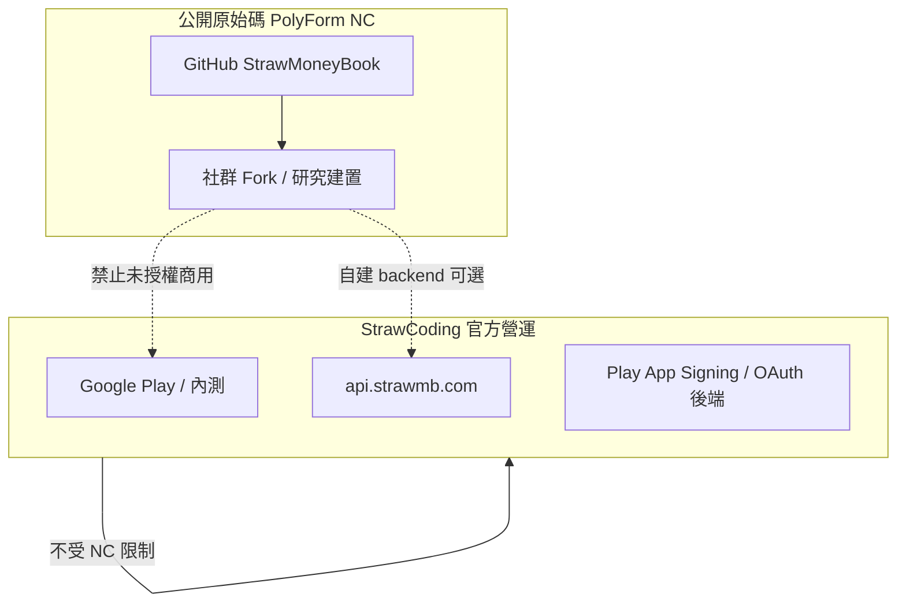

# Open Source & License

## 概述

StrawMoneyBook 以 **公開原始碼** 方式發布於 GitHub，採 **[PolyForm Noncommercial License 1.0.0](https://polyformproject.org/licenses/noncommercial/1.0.0/)**（以下簡稱 **PolyForm NC**）。目標是讓研究者、學生、非營利組織與個人開發者能 **閱讀、學習、修改、再散布**，同時 **禁止第三方未授權的商業利用**。

StrawCoding 仍維運 **官方 Google Play 版**、**內部測試通道** 與 **`api.strawmb.com`**；這些服務的營運 **不** 自動授予任何 fork 或第三方商用權利。

| 資源 | 連結 |
|------|------|
| 原始碼 | [github.com/StrawCoding/StrawMoneyBook](https://github.com/StrawCoding/StrawMoneyBook) |
| 授權全文 | [LICENSE](https://github.com/StrawCoding/StrawMoneyBook/blob/main/LICENSE) |
| 開發者 Wiki | [StrawMoneyBookWiki](https://strawcoding.github.io/StrawMoneyBookWiki/) |
| 文件中心索引 | [Guide / 文件中心](/guide/) |

---

## 01 · 授權條款摘要

### 01.1 允許（Permitted purpose）

PolyForm NC 將 **任何非商業目的** 視為 permitted purpose，典型包括：

| 情境 | 是否允許 |
|------|----------|
| 個人記帳、研究、課程作業、技術部落格引用片段 | ✅ |
| 慈善／教育／公立研究機構內部使用（不對外收費） | ✅ |
| Fork 後自行編譯 APK **僅自用**、不上架商店 | ✅ |
| 修改 UI 或功能後 **無償** 分享原始碼給朋友（仍須附 LICENSE） | ✅ |
| 提交 Pull Request 回主 repo（StrawCoding 審核合併） | ✅ |

### 01.2 禁止（Commercial use）

**商業目的** 不在 permitted purpose 內。以下皆需 **另行取得 StrawCoding 書面商用授權**：

| 情境 | 是否允許 |
|------|----------|
| Google Play / App Store **付費或含 IAP** 上架（即使改包名） | ❌ |
| SaaS、代客記帳、企業內部 **對外收費** 的托管服務 | ❌ |
| 白標／OEM 預載向企業 **收授權費** | ❌ |
| 使用 SMB 程式碼做 **競品** 並以商業模式營運 | ❌ |
| 移除版權與 LICENSE 後再散布 | ❌ |
| 暗示為 StrawCoding **官方** 或官方合作 App | ❌ |

::: warning 判斷原則
若你的使用情境會產生 **營收、訂閱、廣告變現、B2B 合約對價**，即應視為商業目的；有疑慮請先聯絡取得書面確認，而非自行解釋授權。
:::

### 01.3 再散布義務（Notices）

再散布（含 fork 公開、打包釋出）時你 **必須**：

1. 保留根目錄 [`LICENSE`](https://github.com/StrawCoding/StrawMoneyBook/blob/main/LICENSE) 完整文字  
2. 保留檔內 `Required Notice: Copyright (c) 2026 StrawCoding` 一行  
3. 讓下游取得者同樣知悉 PolyForm NC 條款（可附 LICENSE 或官網 URL）

### 01.4 專利與終止

- 授權包含有限 **專利授權**；若你對軟體提出專利侵權指控，專利授權會終止（見 LICENSE Patent Defense）。  
- 首次違反若於 32 日內改正，授權可恢復（見 LICENSE Violations）。

---

## 02 · 與官方產品的關係



- **官方 App** 使用 StrawCoding 控制的簽章、後端 env、Play Console；與你自行編譯的 debug／release **不是同一發佈管道**。  
- 連線 **官方 API** 可能受服務條款／rate limit 約束；自建 backend 見 [Backend API](/guide/backend-api) 與 [Local Dev](/operations/local-dev-quickstart)。

---

## 03 · 本地建置（研究者 / 貢獻者）

### 03.1 取得原始碼

```bash
git clone https://github.com/StrawCoding/StrawMoneyBook.git
cd StrawMoneyBook
git checkout main
```

### 03.2 環境與依賴

- Node.js `^20.19.0 || >=22.12.0`、npm  
- 詳細步驟：[Quick Start](/quick-start)、[Local Dev Quickstart](/operations/local-dev-quickstart)

```bash
npm install
npm install --prefix frontend
npm install --prefix backend
```

### 03.3 環境變數（必讀）

1. 複製 [`frontend/.env.example`](https://github.com/StrawCoding/StrawMoneyBook/blob/main/frontend/.env.example) → `frontend/.env.development.local`  
2. 填入 **你自己的** Google Cloud **Web Client ID**（`VITE_GOOGLE_WEB_CLIENT_ID`）  
3. 預設 dev 前端連 `https://api.strawmb.com`；本機 backend 見 [Environment Variables](/operations/environment-variables)

**禁止提交 git 的項目**（非 exhaustive）：

- `frontend/.env`、`backend/.env`  
- `*.jks` / `*.keystore` / `key.properties`  
- Play 服務帳戶 JSON、OAuth **client secret**  
- 銀行同步真實憑證、SMTP 密碼  

### 03.4 啟動與驗證

```bash
npm run dev:frontend
# 可選本機 backend：
# npm run dev:backend

npm run test:frontend
npm run check
```

UI 改動請依 [Playwright App Shell](/operations/playwright-app-shell) 驗收。

### 03.5 貢獻程式碼

1. Fork → feature branch → PR 至 `main`  
2. 任何原始碼／config 改動需 bump 版本（維護者 merge 後跑 `gpr` 流程）  
3. 勿在 PR 內含 secret；CI 與 review 以主 repo 政策為準  

---

## 04 · Fork 與再散布 FAQ

**Q：可以改 App 名稱與 icon 自己用嗎？**  
A：非商業個人使用一般可接受；若公開散布 fork，仍須保留 LICENSE，且不得暗示官方身份。

**Q：可以放到 F-Droid 或免費開源商店嗎？**  
A：若 **完全免費、無廣告/IAP/訂閱**，且符合 PolyForm NC 非商業定義，可能允許；任何 **商業化或流量變現** 需商用授權。

**Q：公司內部部署給員工用、不對外賣，可以嗎？**  
A：屬 **你的公司** 商業活動的一部分時，PolyForm 定義的 **Your company** 可能涵蓋該使用 → 通常需 **商用授權**。內部評估請走書面授權。

**Q：可以只 reuse `core/` 或某個 service 到別的專案嗎？**  
A：該專案整體若為商業產品，derive 自 SMB 的程式碼同樣受 NC 限制。

**Q：官方會 merge 社群 PR 嗎？**  
A：會依維護容量與路線圖審核；合併後著作權依 CONTRIBUTING／repo 慣例，以 PR 作者與 StrawCoding 協議為準。

---

## 05 · 商用授權

若你需要 **PolyForm NC 未涵蓋的商業使用**（含但不限於上架收費、SaaS、白標、企業批量部署對價），請透過 [GitHub Issues](https://github.com/StrawCoding/StrawMoneyBook/issues) 說明：

- 使用形態（App / Web / 後端托管）  
- 預計使用者規模與是否收費  
- 是否需 StrawCoding 品牌或完全白標  

**在取得書面同意前，請勿開始商業發佈。**

---

## 06 · 維護者內部 SOP（StrawCoding）

公開原始碼 **不** 放寬：

- Play 簽章、Console SA、production `.env` 管理  
- [Release Process](/operations/release-process)、[Closeout & Versioning](/operations/closeout-and-versioning)  
- 銀行原生 APK [Android Native Bank APK](/operations/android-native-bank-apk) 真機閘  

產品行為權威：[StrawMoneyBook_App_Features_Detailed.md](https://github.com/StrawCoding/StrawMoneyBook/blob/main/StrawMoneyBook_App_Features_Detailed.md)。

---

### 下一步

- [文件中心](/guide/) — 全站模組索引（對標 XMCL 文件中心結構）  
- [Quick Start](/quick-start) — 最小可跑環境  
- [Architecture Overview](/architecture/overview) — 系統邊界
